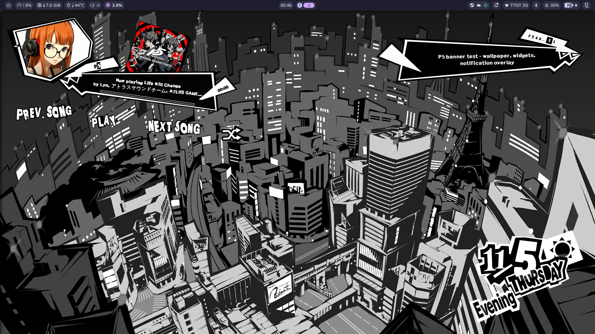

# P5 Widgets — Native C++23 for Umbriel + Noctalia

A native P5 desktop rice for **[Umbriel](https://docs.noctalia.dev/umbriel/)**
and **[Noctalia v5+](https://docs.noctalia.dev/noctalia/)**:



- **Notifications** — Noctalia stays the notification server; the native daemon monitors `Notify` calls and renders the P5 sticker banner.
- **Music** — P5 confidant player with MPRIS controls, ransom-note Jitter text,
  album art, seek bar and animated character frame.
- **Calendar** — layered P5 calendar on **every monitor**, synced to
  local time, with Noctalia weather icons.
- **Weather** — reads Noctalia's existing weather cache; no second API key or poller.
- **Wallpaper automation** — day / afternoon / night P5 City wallpapers driven by
  sunrise, sunset and the same eight-phase timeline as the calendar.
- **Asset overrides** — every banner, character frame, calendar folder and
  wallpaper can be changed from **Settings → Plugins → P5 Plugin**.
- **Noctalia bridge** — plugin settings and `p5-rice-ctl` controls.

No Qt, no QML, no Quickshell. Everything renders with Wayland layer-shell + Cairo/Pango,
in the same C++23 ecosystem as Umbriel.

> Fan-made, not affiliated with Atlus/SEGA. The C++ renderer has procedural
> P5 fallbacks, but the bundled artwork unlocks the intended look.
>
> Native C++23 reimplementation inspired by
> [JDevera101/Persona-rice](https://github.com/JDevera101/Persona-rice); layered
> calendar artwork from [Mive82/Persona-5-Calendar](https://github.com/Mive82/Persona-5-Calendar).

---

## Quick start

```bash
git clone <this-repo> p5-widgets
cd p5-widgets
./install.sh --check      # verify compilers, pkg-config modules and runtime tools
./install.sh              # build, install assets/plugin/service and restart
```

All asset overrides and the wallpaper timeline live in **Settings → Plugins →
P5 Plugin**.

Then open an empty workspace (desktop widgets sit on the `BOTTOM` layer):

```bash
p5-rice-ctl status
p5-rice-ctl calendar on
p5-rice-daemon --calendar-preview /tmp/p5cal.png
```

If the weather icon is missing:

```bash
noctalia msg config-set weather.enabled true
noctalia msg config-set location.auto_locate true   # or set location.address
```

The calendar picks up the next Noctalia cache write within 60 seconds.

---

## Repository layout

```
src/
  app/
    main.cpp                 daemon entry, Wayland globals, output slots, timer loop
    ctl.cpp                  p5-rice-ctl D-Bus client
  core/
    common.*                 paths, fonts, colours, image loading, process helpers
    shm_buffer.*             double-buffered wl_shm + Cairo surfaces
    image_cache.*            shared weak-ref image cache + pre-scaling
    asset_config.*           assets.conf parser for Settings overrides
  ipc/
    dbus_notifications.*     Notify monitor + control bus
    dbus_mpris.*             MPRIS2 client and album-art fetch
  notifications/
    notification_event.hpp   plain event struct shared by IPC and rendering
    notification_surface.*   P5 notification banner overlay
  music/
    music_surface.*          P5 music widget and hit testing
    jitter_text.*            deterministic ransom-note glyph renderer
  calendar/
    calendar_surface.*       per-output calendar layer + time-of-day mapping
  weather/
    noctalia_weather.*       read-only bridge to Noctalia's weather.json
    day_phase.*              eight-phase sunrise/sunset timeline
  wallpaper/
    wallpaper_automation.*   time-based day/afternoon/night wallpaper switching

assets/
  p5notify/                  notification banner, fonts, sound
  p5music/              music banner, character frame, fonts
  p5calendar/                layered day/month/week/ToD/weather art (606 art files + license)
  p5wallpaper/               P5 City day/afternoon/night wallpapers

noctalia/plugins/p5-plugin/   Luau bridge plugin (settings, bar widget, IPC)
umbriel/config.toml              reference Umbriel config + layer rule
bin/                             screen recorder helper
protocols/                       wlr-layer-shell XML
```

### Module dependency graph

```
app/main
  ├─ notifications ── core
  ├─ music ── ipc ── core
  ├─ calendar ── weather ── core
  ├─ wallpaper ── weather ── core
  └─ ipc
```

Both Meson and CMake build the same seven static libraries:

| Target | Contents |
|---|---|
| `p5core` | common utilities, shm buffers, image cache, asset config |
| `p5weather` | Noctalia weather parser, WMO mapping and day-phase timeline |
| `p5ipc` | notification D-Bus monitor and MPRIS client |
| `p5notifications` | notification overlay renderer |
| `p5music` | music overlay renderer and Jitter text |
| `p5calendar` | calendar renderer and layer surface |
| `p5wallpaper` | sunrise/sunset wallpaper automation |
| `p5-rice-daemon` | links the modules and owns the Wayland event loop |
| `p5-rice-ctl` | standalone control CLI |

---

## Installer

`install.sh` is idempotent and checks dependencies before building.

```bash
./install.sh --check                 # report only; exits non-zero on missing requirements
./install.sh                         # build + install + restart the user service
./install.sh --umbriel               # also append the p5 layer rule to Umbriel
./install.sh --no-service            # install files but leave the running daemon alone
./install.sh --no-noctalia-settings  # do not change Noctalia notification settings
./install.sh --help
```

What `--check` verifies:

- Commands: `meson`, `ninja`, `pkg-config`, `wayland-scanner`, a C++ compiler.
- pkg-config modules: `wayland-client`, `wayland-cursor`, `wayland-protocols`,
  `cairo`, `pangocairo`, `pangoft2`, `fontconfig`, `gdk-pixbuf-2.0`, `gio-2.0`,
  `glib-2.0`, `libsystemd`, `libcurl`.
- Runtime: `noctalia`, `umbriel`; optional `pw-play`.
- Session: `WAYLAND_DISPLAY`, `XDG_RUNTIME_DIR`, `DBUS_SESSION_BUS_ADDRESS`.
- Bundled calendar/wallpaper asset counts.
- `~/.local/bin` in `PATH`.

On failure the installer prints a distro-specific package command (Arch, Debian,
Fedora). It refuses to build until the build requirements are present.

Safety guarantees:

- User assets are copied with `cp -a -n` and are not overwritten; only the
  bundled Vietnamese-enabled `PersonifiedUXRegular.ttf` is refreshed on purpose.
- Existing binaries and the Noctalia plugin are backed up under
  `~/.config/noctalia/backup-p5-<timestamp>/`; the installer keeps only the
  **two newest** backup folders and prunes older ones.
- The plugin is installed to
  `${XDG_DATA_HOME:-~/.local/share}/noctalia/plugins/p5-plugin` (the
  Noctalia v5 local-plugin directory) and enabled after the daemon starts.
- `--umbriel` never replaces a split user config. It only appends the layer rule
  to `layer_rules.toml` (with a backup) when `p5calendar` is absent.
- `--no-service` no longer kills a running daemon.

Build manually if preferred:

```bash
meson setup build && meson compile -C build
# or
cmake -S . -B build-cmake && cmake --build build-cmake -j"$(nproc)"
```

---

## Notifications

By default the notification server stays **Noctalia's**:

- Noctalia owns `org.freedesktop.Notifications` and keeps its history/filter pipeline.
- `p5-rice-daemon` uses `org.freedesktop.DBus.Monitoring.BecomeMonitor` to passively
  capture every `Notify` call and render the P5 banner.
- Noctalia's own toast and sound are hidden by the `p5_suppress_toast`
  filter (`show_toast=false`, `play_sound=false`, `save_history=true`).
- The installer restores `notification.enable_daemon=true` and normal DND; it
  sets the filter rather than disabling Noctalia's daemon.

The daemon also enforces the same setup at startup, so starting the widget
service does not leave Noctalia's daemon disabled. `--no-noctalia-settings`
only skips the installer's one-time writes; the daemon still applies the
monitor/filter setup at startup. Use `--no-notify` if you want the daemon to
leave Noctalia notifications completely untouched.

When Noctalia's Do Not Disturb is **on**, the daemon suppresses P5 banners and
the P5 notification sound too. Noctalia still receives the notification and can
keep it in history. This is controlled by `respect_noctalia_dnd` (default
`true`) in **Settings → Plugins**; turn it off if you want P5 banners to ignore
DND.

Banners are queued and displayed **one at a time**. A burst of 3-4
notifications no longer stacks several stickers on screen: the current banner
finishes or is dismissed, then the next queued one slides in. The surface is
sized for a single banner, and body text wraps to up to three lines while
preserving explicit newlines.

**Click to open the sender app**: clicking the text on a banner (the title tag
or the body panel) launches the app that raised the notification — resolved via
its `desktop-entry` hint, then fuzzy app-name matching, then `PATH` — and
dismisses the banner everywhere. When the sender's window is currently stowed
in Umbriel's scratchpad, the click only dismisses the banner
(`notification_scratchpad_block`, default on), so a hidden window is never
yanked back onto screen. Clicks on the artwork itself always just dismiss.

Modes:

| Mode | Behaviour |
|---|---|
| default | Noctalia serves; p5 monitors and draws banners |
| `--no-notify` | p5 banner module disabled; Noctalia behaves normally |

If Noctalia's notification daemon is disabled, default monitor-only mode has no
server to serve apps — keep `notification.enable_daemon=true`.

Verify the live owner and server:

```bash
busctl --user list | grep org.freedesktop.Notifications
busctl --user call org.freedesktop.Notifications /org/freedesktop/Notifications \
  org.freedesktop.Notifications GetServerInformation
noctalia msg config-get notification.enable_daemon   # expected: true
noctalia msg config-get notification.filter.p5_suppress_toast.show_toast
```

---

## Calendar

The calendar is a passive layer-shell surface on the `BOTTOM` layer, one instance
per connected `wl_output`. It has an empty input region, no keyboard focus and no
exclusive zone, so it never blocks desktop clicks. Hotplug is handled in the
daemon's registry listener.

It reproduces the original Rainmeter skin rather than approximating it:

- `Bottom` shadow → middle cut-out → `Top` colour layer.
- Month asset shifts with `month * 100` on two-digit days.
- Vanilla art normally; Royal inverted art in January/February (`version = 2`).
- Time of day follows the eight-phase sunrise/sunset timeline below.
- Weekday lookup uses a fixed English table, so a Vietnamese or other non-English
  locale cannot break asset paths.
- Weather frames animate every 450 ms and use the icon position variant for
  one-digit vs two-digit days.

### Calendar configuration

Every option is both a CLI flag and an environment variable, which makes systemd
drop-ins easy:

| Flag | Environment | Default | Meaning |
|---|---|---|---|
| `--calendar-size` | `P5_CALENDAR_SIZE` | `400` | Logical width; height follows 835:653 |
| `--calendar-position` | `P5_CALENDAR_POSITION` | `bottom-right` | `top-left`, `top-right`, `bottom-left`, `bottom-right` |
| `--calendar-margin` | `P5_CALENDAR_MARGIN` | `24` | Corner margin in logical px |
| `--calendar-version` | `P5_CALENDAR_VERSION` | `2` | `0` vanilla, `1` Royal, `2` dynamic Jan/Feb |
| `--calendar-weather` | `P5_CALENDAR_WEATHER` | `on` | Use Noctalia weather cache |
| — | `P5_CALENDAR_WEATHER_MAX_AGE` | `7200` | Hide snapshots older than this |
| — | `P5_CALENDAR_WEATHER_CACHE` | `$XDG_CACHE_HOME/noctalia/weather.json` | Cache override for fixtures |
| `--no-calendar` | `P5_CALENDAR_ENABLED=0` | enabled | Disable the surface |
| `--calendar-preview <png>` | — | — | Render a PNG and exit |
| `--calendar-time <unix>` | — | now | Timestamp for preview |

Example systemd override:

```bash
systemctl --user edit p5-widgets.service
# [Service]
# Environment=P5_CALENDAR_POSITION=bottom-right
# Environment=P5_CALENDAR_SIZE=360
```

The calendar is always active in this setup; hide it temporarily
with `p5-rice-ctl calendar off`.

### Weather

Noctalia owns location resolution and Open-Meteo polling. The calendar reads
`$XDG_CACHE_HOME/noctalia/weather.json` only — no network request, no API key.
WMO `weather_code` + `is_day` are mapped to the P5/OpenWeatherMap icon
set (`01d`, `02n`, `04d`, `09d`, `10n`, `11d`, `13d`, `50d`, …). Snapshots older
than `P5_CALENDAR_WEATHER_MAX_AGE` are rejected, so disabling Noctalia weather
does not leave a stale icon on screen.

### Eight-phase timeline

The calendar and wallpaper share the same timeline. Sunrise and sunset are read
from Noctalia's weather cache when available; otherwise the fallback is 06:00 /
18:00.

| Phase | Window | Calendar ToD asset | Wallpaper |
|---|---|---|---|
| Midnight | 00:00 – 01:00 | Evening (1) | night |
| Late Night | 01:00 – 03:00 | Evening (1) | night |
| Early Morning | 03:00 – sunrise | Early Morning (2) | night |
| Morning | sunrise – 10:00 | Morning (3) | day |
| Daytime | 10:00 – 12:00 | Daytime (4) | day |
| Afternoon | 12:00 – sunset | Afternoon (5) | afternoon |
| Evening | sunset – dusk (sunset + 22 min) | Evening (6) | afternoon |
| Night | dusk – midnight | Evening (1) | night |

The original P5 calendar only has six ToD images, so Midnight, Late Night
and Night reuse the Evening artwork. The weather icon itself still follows
Noctalia's real `is_day` flag.

### Wallpaper automation

`p5wallpaper` applies a P5 City wallpaper when the phase changes:

- **day** → `p5cityday.png`
- **afternoon/evening** → `p5cityafternoon.png`
- **night/early morning** → `p5citynight.png`

Defaults are installed under `~/.config/noctalia/p5-rice/p5wallpaper/`; the
installer copies them from `assets/p5wallpaper/`. The daemon checks once per
minute, only switches on a variant change, calls
`noctalia msg wallpaper-set <path>`, and is disabled outside the `persona`
You can replace any image from **Settings → Plugins**, or verify the active
wallpaper with:

```bash
noctalia msg wallpaper-get
```

---

## Asset overrides (Settings → Plugins)

The Noctalia plugin exposes every visual asset path in **Settings → Plugins →
P5 Plugin**. Empty values keep the bundled defaults.

| Setting | Type | What it changes |
|---|---|---|
| `respect_noctalia_dnd` | bool | Suppress P5 banners/sound while Noctalia DND is on |
| `notification_timeout_seconds` | int | Banner auto-dismiss seconds; `0` follows each app (6 s default), `1-120` forces a fixed time |
| `notification_volume` | int | Banner sound volume (0-100, `0` silent) |
| `notification_scratchpad_block` | bool | Banner text never opens an app whose window is stowed in Umbriel's scratchpad |
| `notification_banner` | file | Notification banner image |
| `notification_sound` | file | Notification pop sound |
| `notification_font` | file | Notification title font |
| `ui_font` | file | Shared notification body / music UI font |
| `music_font` | file | Jitter music-button font |
| `music_banner` | file | Music widget banner |
| `music_character_frame` | file | Character portrait frame |
| `music_character_name` | text | Name tag text |
| `calendar_assets_dir` | folder | Folder containing `Day`, `Month`, `Week`, `ToD`, `Weather` |
| `wallpaper_auto_enabled` | bool | Enable automatic wallpaper switching |
| `wallpaper_day` | file | Morning/day wallpaper |
| `wallpaper_afternoon` | file | Afternoon/evening wallpaper |
| `wallpaper_night` | file | Night wallpaper |

The plugin service writes those values to
`~/.config/noctalia/p5-rice/assets.conf`; the daemon reads the file at startup.
The service restarts `p5-widgets.service` only when an asset path actually
changes, so toggling the calendar/music does not interrupt the widgets. The file
is plugin-managed: use the Settings UI for persistent changes (manual edits are
useful for testing but will be replaced on the next settings reload). Both `~`
and absolute paths are supported. For `calendar_assets_dir`, select either the
folder that directly contains `Day/`, `Month/`, `Week/`, `ToD/` and `Weather/`,
or its parent that contains an `Assets/` folder.

A missing custom file falls back to the bundled asset (or the procedural Cairo
fallback for the calendar).

---

## Music widget and hover

The music widget is anchored top-left, `BOTTOM` layer, namespace
`noctalia-desktop-widget-p5music`. It listens to MPRIS2 and Noctalia's
`dev.noctalia.Mpris` active-player service.

Hover hit boxes are **fixed generous regions**, not the tight text bounding
boxes. The Jitter renderer rotates and scales each glyph and adds 14-ring sticker
outlines, so measured text bounds made the edges of "PREV. SONG", "PLAY",
"NEXT SONG" and shuffle feel dead. The regions now cover the whole sticker plus
surrounding space. They live at the top of `MusicSurface::hit_test()` in
`src/music/music_surface.cpp` if you want to tune them.

Other music-widget behaviour:

- The `PREV. SONG` / `PLAY` / `NEXT SONG` / shuffle row keeps the original
  wide spacing, with generous hover hit boxes.
- Seek bar hit area has extra vertical padding.
- Hovering the seek bar no longer forces a full re-render on every pointer move.
- PLAY/PAUSE label updates automatically from MPRIS state.
- Shuffle lights up when the player reports shuffle support and is active.
- Album art supports `file://` and HTTP(S) via libcurl.
- Album art fills the square 213×213 card with a cover crop; excess from
  non-square artwork is cropped away.
- Some players (for example Brave's MPRIS implementation) only expose a small
  temporary artwork file (often 150×83); that source resolution is kept as-is.

---

## IPC and controls

### `p5-rice-ctl`

```bash
p5-rice-ctl status
p5-rice-ctl notify "PHANTOM THIEVES" "Take Your Heart!"
p5-rice-ctl dismiss-all
p5-rice-ctl music on|off
p5-rice-ctl toggle-music
p5-rice-ctl calendar on|off
p5-rice-ctl toggle-calendar
p5-rice-ctl play-pause
p5-rice-ctl next
p5-rice-ctl prev
```

### D-Bus control interface

`dev.noctalia.P5Rice` on `/dev.noctalia.P5Rice`:

```
Notify(s summary, s body, s app, u urgency, i timeout) -> u
GetProfile() -> s        # always "persona"
DismissAll()
SetMusicVisible(b)
ToggleMusic()
SetCalendarVisible(b)
ToggleCalendar()
PlayPause()
Next()
Prev()
```

### Noctalia plugin

`noctalia/plugins/p5-plugin/` provides:

- plugin settings `music_widget_enabled`, `calendar_widget_enabled`, plus all
  asset/wallpaper overrides documented in **Asset overrides** above;
- a bar widget showing `P5`;
- an IPC service that mirrors settings to `p5-rice-ctl`, writes
  `~/.config/noctalia/p5-rice/assets.conf`, restarts the daemon only when asset
  paths change, and accepts `calendar on|off`, `toggle-calendar`,
  `toggle-music` events.

The installer places it at
`${XDG_DATA_HOME:-~/.local/share}/noctalia/plugins/p5-plugin` (the Noctalia
v5 local-plugin directory) and enables `okarin/persona-plugin` automatically.

Validate it offline:

```bash
noctalia plugins lint noctalia/plugins/p5-plugin
```

Dispatch an event:

```bash
noctalia msg plugin okarin/persona-plugin:service all toggle-calendar
```

---

## Layer namespaces

| Surface | Namespace | Layer | Anchor |
|---|---|---|---|
| Notifications | `noctalia-p5notify` | `overlay` | top-right |
| Music | `noctalia-desktop-widget-p5music` | `bottom` | top-left |
| Calendar | `noctalia-p5calendar` | `bottom` | bottom-right (configurable) |

The bundled Umbriel template excludes all three from blur. If you use split
Umbriel configs, run `./install.sh --umbriel`; it appends this rule to
`layer_rules.toml` only if missing:

```toml
[[layer_rule]]
match.namespace = "^noctalia-(p5notify|p5calendar|desktop-widget-p5music)$"
blur = false
```

Inspect live surfaces:

```bash
umbriel layers | grep -E p5notify|p5calendar|p5music
```

---

## Performance notes

The widgets are designed to stay cheap on multi-monitor setups:

- **Shared image cache** (`core/image_cache.*`) uses weak references, so two
  monitors share one decoded banner/character/calendar image. Assets are freed
  as soon as no surface needs them.
- **Calendar assets are decoded at widget resolution** (e.g. 400×313) instead of
  keeping thirteen 835×653 surfaces per output.
- **Notification banner is pre-scaled** to 700 px; **character frames** to
  352×272. This removed several large source surfaces per monitor.
- **The notification layer is one banner tall** and only renders the front of
  the queue, instead of allocating a five-banner column.
- **Calendar art unloads while hidden** and skips weather/time polling; it
  reloads on show.
- **Seek-bar hover** only re-renders when the zone changes, not on every motion.
- **MPRIS polling is adaptive**: the `Position` property is only queried while
  playing (500 ms), full player refresh runs 1 s playing / 5 s idle and is
  skipped entirely when the music widget is disabled.
- **Wallpaper automation checks once per minute** and only spawns
  `noctalia msg wallpaper-set` when the phase variant changes.
- **Asset-setting changes restart the daemon only when an asset path actually
  changed**; calendar/music toggles never interrupt the widgets.
- Idle timer is 250 ms; animation timer is 16 ms while notification/music
  animations are active.

Measured on the development machine (two 1920×1080 outputs, notifications +
music + calendar): `MemoryCurrent` dropped from roughly **105 MB to 65 MB** after
the shared-cache/pre-scale changes, with all functionality intact. Exact numbers
depend on MPRIS album art and the number of live notifications.

---

## Troubleshooting

**DND is on but P5 banners still show**
Set `respect_noctalia_dnd` to true in **Settings → Plugins → P5 Plugin**, or
check the effective value:

```bash
grep respect_noctalia_dnd ~/.config/noctalia/p5-rice/assets.conf
```

The daemon caches DND for at most one second.

**The weather icon is missing**
Noctalia's weather service is disabled, the cache is stale (> `P5_CALENDAR_WEATHER_MAX_AGE`),
or the location is unset. Enable it and wait for one refresh:

```bash
noctalia msg config-set weather.enabled true
noctalia msg config-set location.auto_locate true
stat ~/.cache/noctalia/weather.json
```

**The calendar is not visible**
- It sits on the `BOTTOM` layer, so normal windows cover it; check an empty
  workspace.
- Verify the layer: `umbriel layers | grep p5calendar`.
- Toggle it: `p5-rice-ctl calendar on`.

**An old test layer is stuck on screen**
Disable stale local plugins:

```bash
noctalia msg plugins list
noctalia msg plugins disable <author/plugin>
umbriel layers | grep noctalia-plugin
```

The old testcal experiment has been removed from this workspace.

**An asset setting does not apply**
Check the generated config and the daemon log:

```bash
cat ~/.config/noctalia/p5-rice/assets.conf
journalctl --user -u p5-rice-daemon -n 20 --no-pager
```

The service writes the file and restarts the daemon when the signature changes.
If you edited `assets.conf` by hand, restart once:
`systemctl --user restart p5-widgets.service`. Invalid paths fall back to the
bundled art.

**The wallpaper does not switch**
- `wallpaper_auto_enabled` must be true in **Settings → Plugins**.
- Confirm the phase and the active file:

```bash
date
noctalia msg wallpaper-get
ls ~/.config/noctalia/p5-rice/p5wallpaper/
```

- Sunrise/sunset come from Noctalia's weather cache; enable weather for accurate
  boundaries, otherwise the fallback is 06:00/18:00.
- The automator only changes the wallpaper when the variant changes, at most
  once per minute.

**Hover feels wrong on the music widget**
The row uses the original wide spacing with generous hover hit boxes. The four
`point_in_rotated_center_box(...)` calls and `kBtn*` constants in
`MusicSurface::hit_test()` / `music_surface.hpp` are the tuning points.

**Notifications appear twice / Noctalia toast still shows**
The default monitor-only setup relies on the filter hiding Noctalia's toast:

```bash
noctalia msg config-get notification.enable_daemon      # expected: true
noctalia msg config-get notification.filter.p5_suppress_toast.enabled
noctalia msg config-get notification.filter.p5_suppress_toast.show_toast
```

If Noctalia's notification daemon was disabled by an older setup,
`notification.enable_daemon` may still be false; rerun `./install.sh` or set it
to true.

Run `./install.sh` again or `./install.sh --no-noctalia-settings` if you manage
those settings yourself.

**CodeGraph looks stale after the refactor**
The source tree moved into `app/`, `core/`, `ipc/`, `notifications/`, `music/`,
`calendar/`, `weather/` and `wallpaper/`. Re-run your usual CodeGraph index
command so its symbol paths match the new layout.

---

## Uninstall

```bash
systemctl --user disable --now p5-widgets.service
rm -f ~/.local/bin/p5-rice-daemon ~/.local/bin/p5-rice-ctl
rm -rf ~/.local/share/noctalia/plugins/p5-plugin
# Restore Noctalia's default notification behaviour
noctalia msg config-set notification.enable_daemon true
noctalia msg config-set notification.filter.p5_suppress_toast.enabled false
noctalia msg notification-dnd-set false
# Optional: remove installed art after backing up any custom files
# rm -rf ~/.config/noctalia/p5-rice
```

Umbriel and Noctalia themselves are untouched.

---

## Credits

- Original Persona-rice project and inspiration:
  [JDevera101/Persona-rice](https://github.com/JDevera101/Persona-rice).
- Calendar art: [Mive82/Persona-5-Calendar](https://github.com/Mive82/Persona-5-Calendar),
  based on vector assets by Reddit user **BHDown**. The original WTFPL license is
  kept at `assets/p5calendar/LICENSE`.
- Persona 5 is a trademark of Atlus/SEGA. This is a fan-made, non-commercial rice.
- Built for [Noctalia](https://github.com/noctalia-dev/noctalia) and
  [Umbriel](https://github.com/noctalia-dev/umbriel).
